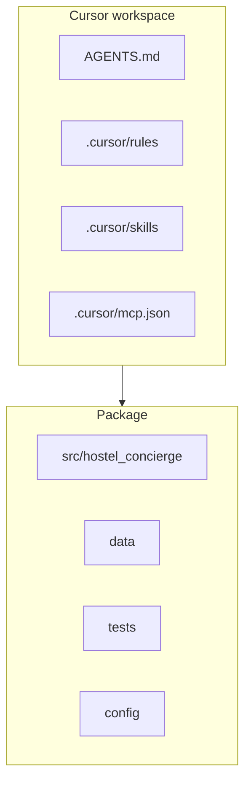

# Story 1 — Repo and Cursor workspace

## Functionality

- Python package `hostel_concierge` with `pyproject.toml`, `requirements.txt`, and `.python-version` 3.12.
- `AGENTS.md` states the stack and the rules that later code must not break.
- Cursor rules in `.cursor/rules/`, skills in `.cursor/skills/`, and three agent briefs in `.cursor/agents/`.
- `.cursor/mcp.json` points at the local hostel MCP server.
- Empty-of-logic layout for `data/`, `config/`, `tests/`, `traces/`, and `docs/`.

## Best practices

- Safety rules are files the editor loads, not a paragraph that disappears when the chat scrolls.
- Skills capture repeated workflows (traces, new tools, approval resume) so the next session does not reinvent them.
- The MCP server is configured before the tools exist, so the tool process is part of the project rather than an afterthought.
- Dependencies are declared once. Tests add `src` via pytest `pythonpath`.

## Shape



## Verify

```bash
PYTHONPATH=src .venv/bin/python -m pytest
```

## Learning note

The useful part of the Cursor setup is the split between rules and skills. Rules are invariants (who may call which tool). Skills are procedures (how to regenerate R1–R7). Mixing those two makes the agent either nag or forget.
