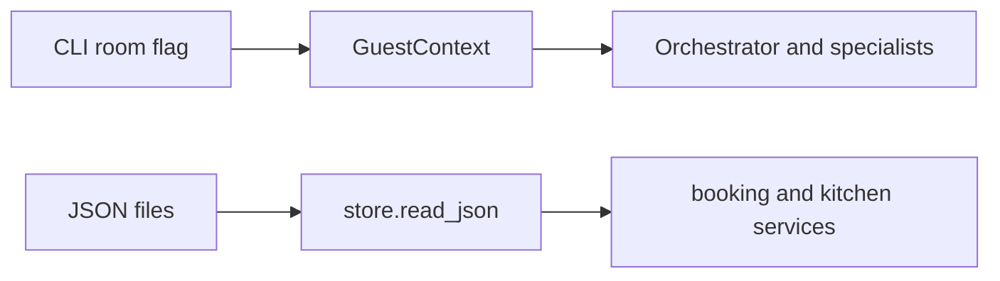

# Story 2 — Mock data and guest context

## Functionality

- `data/guests_bookings.json` has five guests. Room 305 is checked in, room 101 is checked out, room 412 is booked and not yet arrived, room 204 is another checked-in guest used for the block test.
- `data/menu.json` has eight dishes. Masala Omelette has stock 0. Peanut Chikki lists peanuts.
- `data/kitchen_hours.json` has breakfast, lunch, and dinner windows.
- `GuestContext` is a pydantic model with `extra="forbid"`. The app builds it with `guest_in_room`. The model has no field for it on any tool.

## Best practices

- Identity is a trust boundary. The login (here, `--room`) creates the context. Text the guest types is not allowed to replace it.
- Plain JSON is the whole database so a reviewer can see the world without a server.
- Tests copy `data/` into a temp directory. The repo files stay at the initial state.
- `HOSTEL_NOW` freezes "is the kitchen open?" so a demo at 11:00 does not randomly fail.

## Shape



## Verify

```bash
PYTHONPATH=src .venv/bin/python -m pytest tests/test_domain.py -q
```

## Learning note

The context object is small on purpose. Once guest id and room are ordinary tool arguments, the model can be talked into fetching room 204. Keeping them off the schema is the fix; the prompt is only a reminder.
