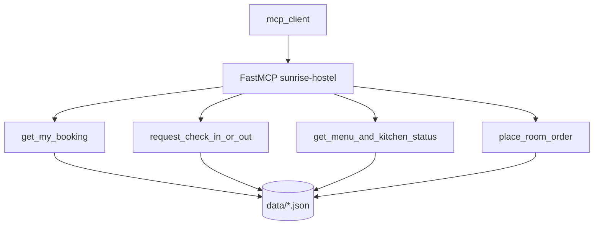

# Story 3 — MCP tools

## Functionality

Four tools in `mcp_server/server.py`:

| Tool | Kind | Effect |
| --- | --- | --- |
| `get_my_booking` | read | Room, dates, status for the bound guest |
| `request_check_in_or_out` | approval | Proposal only |
| `get_menu_and_kitchen_status` | read | Menu, stock, allergens, open or closed |
| `place_room_order` | approval | Proposal only, after hours and stock checks |

Specialists call them through `mcp_client.py` (`fastmcp.Client` against the in-process server). A missing booking, a closed kitchen, and a sold-out item return a status dict.

## Best practices

- The tool is the capability boundary. Agents do not open the JSON files themselves.
- A gated tool that writes "just this once" breaks the approval story, so these tools never write.
- `run_in_thread=False` keeps the tool on the caller thread, which is where `bind_guest` set the context.
- Errors the guest can understand are return values. The wrapper still catches unexpected exceptions so the chat does not dump a traceback.

## Shape



## Verify

```bash
PYTHONPATH=src .venv/bin/python -m hostel_concierge.mcp_smoke
PYTHONPATH=src .venv/bin/python -m pytest tests/test_mcp.py -q
```

## Learning note

In-process MCP still counts: the specialist goes through `list_tools` / `call_tool`, and the tool schema is what a model is allowed to fill. Guest id never appears there. Cursor's `.cursor/mcp.json` is the same server over stdio, with room 305 bound from the environment for the inspector only.
