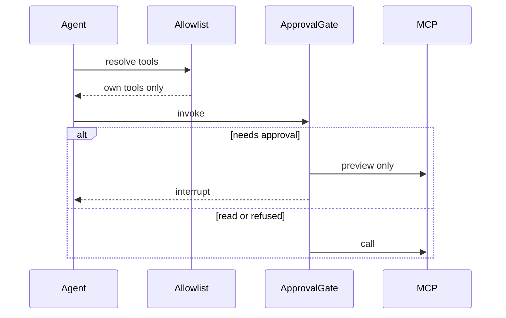

# Story 4 — Safety layer

## Functionality

- `config/safety.yaml` names the approval tools, the per-agent caps, and the two allow-lists.
- `visible_tools` intersects the live MCP list with the allow-list.
- `run_gated_or_direct` strips identity arguments, calls MCP, and `interrupt()`s on `pending_approval`.
- `grant_approval` is the only way `commit` will write. Without it the function returns `approval_missing`.
- `CallLimiter` stops a specialist that keeps calling a tool or a model.

## Best practices

- Fail closed. An unknown tool name is an error payload, not a pass-through.
- Config decides which tools pause, so adding a risky tool is a YAML change plus a commit function, not a prompt edit.
- The approval token is process state the model cannot see and cannot set.
- Limits are counters, not a sentence in the system prompt. The message starts with `Stopped:` so a demo can point at it.

## Shape



## Verify

```bash
PYTHONPATH=src .venv/bin/python -m pytest tests/test_scope_and_safety.py tests/test_domain.py -q
```

These tests do not need a live model beyond the direct gate and limiter calls. The allow-list test does load the MCP catalog.

## Learning note

The system prompt and the gate answer different failures. The prompt helps the model ask a polite question. The gate is what still works when the model emits the wrong tool call anyway. That is why `test_kitchen_cannot_call_a_booking_tool` calls the gate with the wrong name instead of trusting the prompt.
