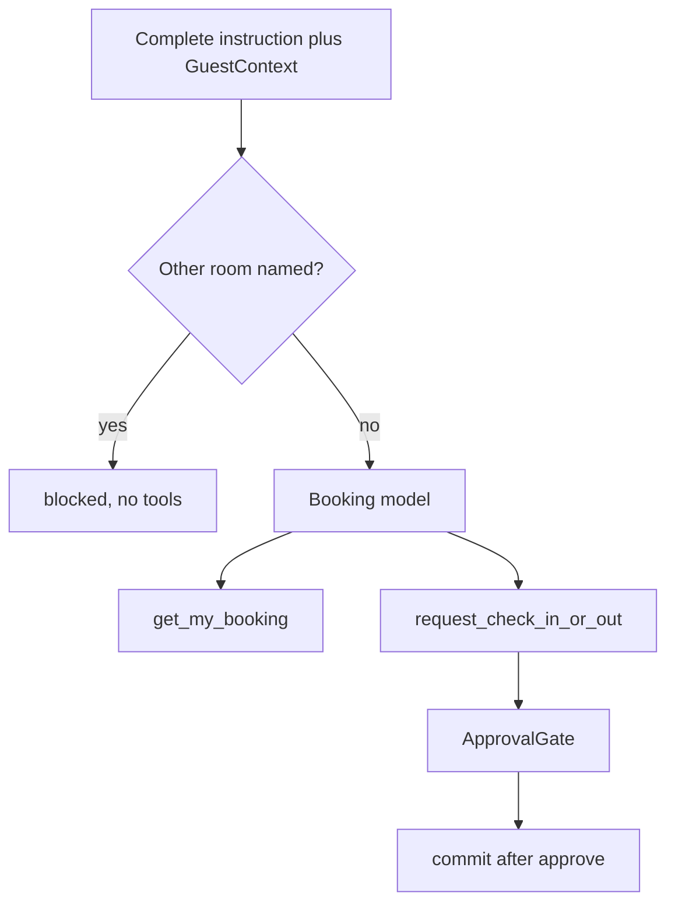

# Story 5 — Booking specialist

## Functionality

`run_specialist("booking", instruction, guest)` loads only the booking tools, binds the guest, and loops a tool-calling model under `CallLimiter`.

- A read instruction calls `get_my_booking`.
- Check-in or check-out calls `request_check_in_or_out` and then waits on the approval gate.
- A status that does not allow the action (`booked` cannot check out, `checked-out` cannot check out, `checked-in` cannot check in) comes back as `refused` with no pause.
- A missing time is `needs_detail` rather than a guessed clock time.
- If the instruction names a room other than `guest.room`, the function returns `blocked` and an empty tool trace.

The specialist's only human message is the instruction. There is no chat history parameter.

## Best practices

- Narrow tool list, loaded from MCP and filtered again in code.
- The brief is complete because this agent will not see "she meant the earlier sentence."
- Invalid transitions are data rules in `booking_service.py`, so a confident model cannot talk the file into a bad status.
- The reply text is the tool's `message`, so the orchestrator cannot invent a confirmation the tool did not return.

## Shape



## Verify

```bash
PYTHONPATH=src .venv/bin/python -m pytest tests/test_agents.py::test_read_booking_without_approval tests/test_agents.py::test_approve_and_reject_checkout tests/test_reference.py::test_r1_booking_read tests/test_reference.py::test_r2_checkout_approval -q
```

## Learning note

The specialist is a tool from the orchestrator's point of view, and an agent from the MCP server's point of view. That double role is the pattern: the parent counts the delegation as one tool call, and the child has its own smaller budget and its own allow-list.
