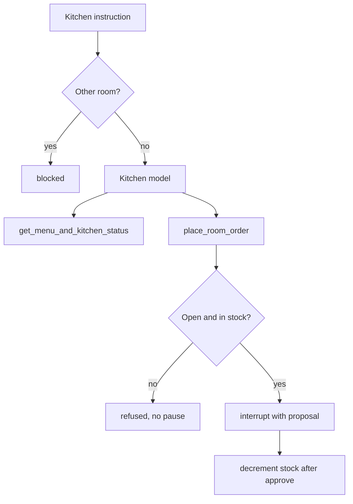

# Story 6 — Kitchen specialist

## Functionality

The kitchen specialist mirrors booking, with `get_menu_and_kitchen_status` and `place_room_order`.

- Menu and hours run with no approval. The reply lists stock and allergens, including peanuts and the sold-out omelette.
- An order is proposed only when the kitchen is open and every named item is in stock. Otherwise the tool returns `kitchen_closed` or `out_of_stock` and does not pause.
- A peanut item adds a warning on the proposal. It does not auto-refuse.
- "Order something" with no dish becomes a question. "Can I get breakfast ready?" is treated as an hours question, not a guessed order.
- Another room in the instruction is blocked the same way as booking.

## Best practices

- Hours and stock are checked in the service, at propose time and again at commit time, so a pause that crosses a closing time still fails closed.
- The order's room is the bound room. The phrase "to my room" does not become a tool argument.
- Approval is for a concrete proposal (names, prices, total), which the guest can reject without a stock change.

## Shape



## Verify

```bash
PYTHONPATH=src .venv/bin/python -m pytest tests/test_agents.py::test_kitchen_closed_and_out_of_stock_do_not_pause tests/test_reference.py::test_r3_order_approval -q
```

## Learning note

Two different "no"s matter. Closed and out of stock are refusals: there is nothing honest to approve. A valid order is a pause: the guest still has to agree before stock moves. Putting both behind the same approval dialog would train the guest to rubber-stamp errors.
