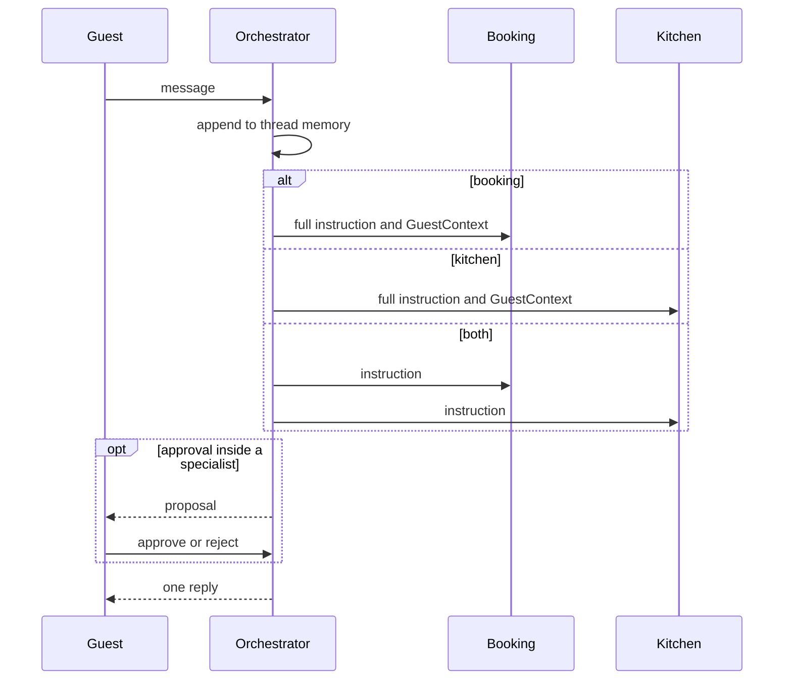

# Story 7 — Orchestrator, memory, and CLI

## Functionality

`build_app` compiles a LangGraph with two nodes: `orchestrator` and `tools`. The checkpointer is in-memory, keyed by a session thread id.

- The model may call only the two specialist tools. Each call counts toward `max_tool_calls`. Each model step counts toward `max_model_calls`.
- `Session.ask` appends the new user message, resets those counters, and sets `guest_id` and `room` from the `GuestContext` the CLI built.
- If a specialist interrupts, `ask` shows the proposal and resumes with approve or reject. The whole turn stays on the same thread.
- Earlier messages stay on that thread, so "and what's on the menu?" is answered with the previous sentence copied into the kitchen brief.
- Weather and other off-topic requests get a decline and no tool call.
- The CLI is `python -m hostel_concierge.cli`. It never asks the guest to type an id.

## Best practices

- One owner of history. Specialists stay stateless with respect to the chat.
- Counters reset per guest message, not per approval resume, so a normal checkout is not eaten by the cap and a loop inside one message still trips it.
- The final answer is the specialists' messages joined. The orchestrator does not add "done" on top of a rejection.
- `HOSTEL_MODEL=bedrock` sends every agent call to Amazon Bedrock. `scripted` is the offline stand-in. The graph, gate, and allow-lists stay put.

## Shape



## Verify

```bash
HOSTEL_NOW=2026-11-24T08:30:00 PYTHONPATH=src .venv/bin/python -m hostel_concierge.cli --room 305
PYTHONPATH=src .venv/bin/python -m pytest tests/test_reference.py tests/test_policy.py -q
```

## Learning note

`interrupt()` inside a tool restarts that tool node on resume. The first run pauses before any write. The second run sees the guest's decision and only then commits. That is why proposals are safe to rebuild: the abandoned proposal id is never granted, and the replay's proposal is the one that gets the token.
