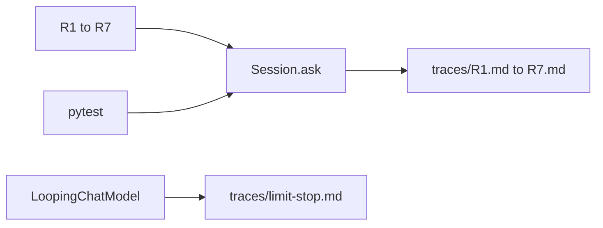

# Story 8 — Traces, design note, demo

## Functionality

- `trace_runner` runs R1–R7 as room 305 against a fresh copy of the mock data and writes `traces/R1.md` … `traces/R7.md`.
- Each trace shows the guest text, the full specialist instruction, the tool status, any approval pause, and the reply.
- `demo_limit` writes `traces/limit-stop.md`: a booking specialist that will not stop calling `get_my_booking`, and an orchestrator that will not stop delegating, both cut off by the caps.
- `docs/design-note.md` answers why the split exists, where the code enforces approval and allow-lists, and how the hard cases were tested.
- `docs/demo-script.md` is the 3–4 minute recording outline: R3 approval, R5 both specialists, then the limit stop.

## Best practices

- Traces are generated, not hand-edited, from the same `Session.ask` path as the CLI.
- Each scenario gets its own data directory so R2's checkout cannot change R5's starting status.
- The design note cites files (`orchestrator.py`, `approval.py`, `scope.py`, the tests) instead of describing a system we wish we had built.
- The demo uses the scripted model so a recording matches the traces. OpenAI remains a config switch, not a second architecture.

## Shape



## Verify

```bash
PYTHONPATH=src .venv/bin/python -m pytest
PYTHONPATH=src .venv/bin/python -m hostel_concierge.trace_runner
PYTHONPATH=src .venv/bin/python -m hostel_concierge.demo_limit
```

## Learning note

The trace is the evidence that delegation happened. A pleasant final sentence is not enough, because that sentence can hide whether one agent did everything. Saving the specialist instruction and the tool status makes the orchestrator pattern visible without a debugger.
